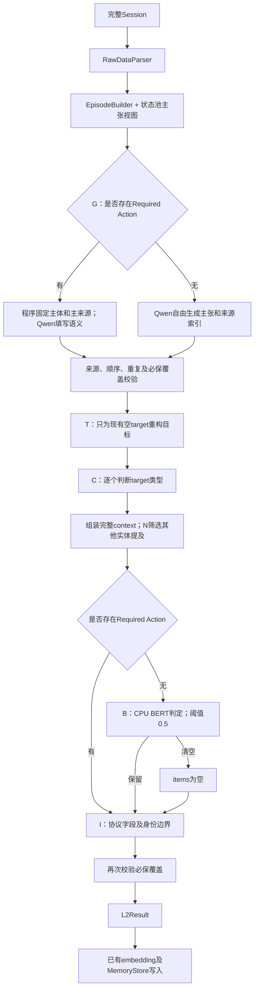

# Workflow1 v4

本分支只迁入已采纳的Workflow1框架。默认模型为Qwen3-1.7B，准入模型为独立的BERT v4。没有采用微调adapter、Qwen3.5-2B或Qwen3-4B实验结果。

## 输入、输出与处理

输入为完整车辆Session。Parser、EpisodeBuilder和车辆状态池沿用仓库已有实现。写入入口将原始Session、完整Episode、差分主张视图和稳定用户引用传给同一工厂。



G输出开放主张，不输出持久化Entity ID。程序校验来源并拼接Evidence.context；MemoryStore继续完成实体绑定。单次已完成行为的环境不自动变成condition。B只保留或清空整份候选，不修复参数；I不代替模型事实判断。

调用、JSON、来源或必保覆盖失败时结束并保留错误；没有自动重试、输出修补或模型回退。合法输出仍可能存在行为性质、参数归属或语义错误，结构校验不代表内容完全正确。

## Python调用

```python
from pathlib import Path
from limem.llm_client import QwenLLMClient
from limem.memory_item_extractor.factory import create_workflow1_extractor

extractor = create_workflow1_extractor(
    QwenLLMClient(), trace_root=Path("var/debug/workflow1-v4")
)
result = extractor.extract(
    episode, claim_episode=claim_episode,
    user_ref=raw_session["user_id"], raw_session=raw_session,
)
```

HTTP写入也使用上述工厂。`config/llm.toml`及DeepSeek/Ollama/SGLang/vLLM模板继续用于巩固等既有功能，不切换Workflow1算法。鉴权、检索、数据库schema和巩固实现没有随本次迁移改变。

## 模型资产

Git只提供框架，不提供Qwen和BERT权重，不包含训练集、142/300评测集、API记录或运行时密钥。

部署需要两份已有模型资产：

1. Qwen3-1.7B完整模型目录。默认放在`llm/Qwen3`，也可用`LIMEM_MODEL_PATH`指定其他目录。
2. 已训练的BERT v4完整目录，放在`llm/bert-behavior-admission-v4`。其文件、字节数和SHA256见[bert-assets.json](bert-assets.json)。本仓库尚未发布该模型的公开下载地址，需从本次LiMem研发资产取得，不能用通用预训练BERT替代。缺失时直接失败。

LiMem默认安装CPU torch 2.6.0及transformers 4.49.0。BERT设置4个CPU线程、0.5阈值，单Record超过512 token报错，不截断、不联网下载。Qwen使用单独的Linux/WSL Python 3.12环境；原验证环境为vLLM 0.10.2、transformers 4.55.2。

```bash
# 在Linux/WSL创建独立的Qwen环境，安装GPU推理依赖。
python3.12 -m venv "$HOME/.venvs/limem-qwen"
"$HOME/.venvs/limem-qwen/bin/python" -m pip install -r scripts/requirements-qwen.txt

# 启动；脚本不会安装或下载权重。
LIMEM_MODEL_PATH=/path/to/Qwen3-1.7B bash scripts/serve_qwen_wsl.sh

# 在LiMem环境中安装并启动服务；云端/embedding凭据按根README填写。
uv sync --locked
uv run python -m limem.service.main
```

Qwen服务名为`qwen`。`config/qwen.toml`固定温度0、seed0、4096输出上限、120秒超时；上下文16384。调用关闭思考模式，使用严格JSON Schema，T使用原256输出上限。服务脚本选择guidance、紧凑JSON且禁止grammar fallback。CPU BERT环境与GPU vLLM环境保持独立。

Docker会只读挂载BERT目录。模型在宿主机时，将`config/qwen.toml`的base_url改为`http://host.docker.internal:8001/v1`，并让Qwen监听容器可达的地址。不要把权重复制进镜像或Git。

## 测试与范围

```bash
uv sync --locked
uv run pytest -q
```

提交内测试使用独立合成小case：严格JSON与非思考参数、提示一致性、T仅修改空目标、原始来源与context保留，以及鉴权HTTP写入到G/TCN/B/I/MemoryStore。HTTP测试通过MockTransport固定模型响应，分别覆盖必保分支、自由分支保留及B清空；它们不宣称验证模型语义能力。

研发侧另用完整142条及保留的原始响应检查迁移等价。本次没有重新调用GPU模型；回放不能证明新鲜生成质量、端到端延迟或能耗。数据和调用日志留在研发目录，不随本分支分发；迁移核对结果见[MERGE-VALIDATION.md](MERGE-VALIDATION.md)。
